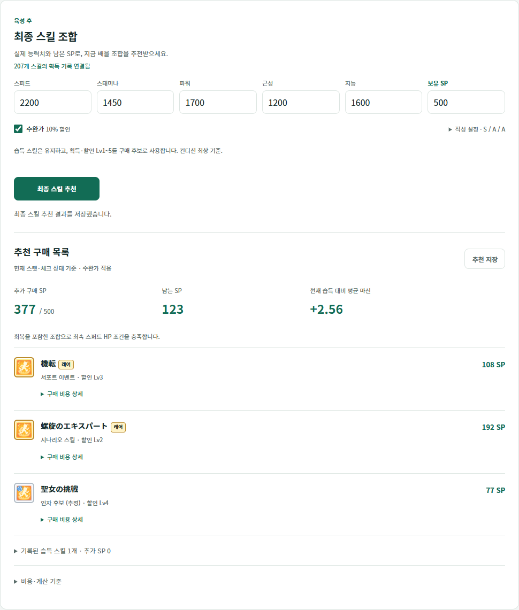
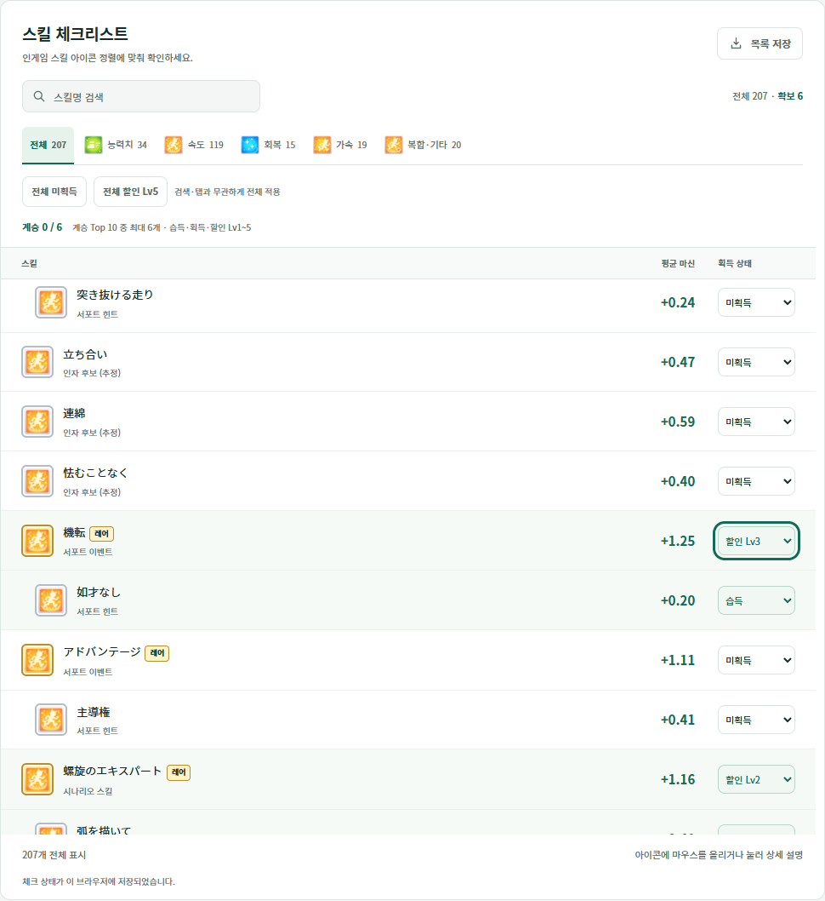
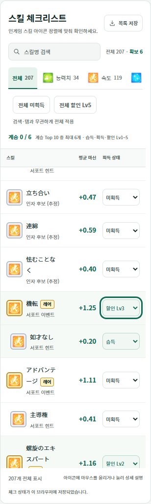

# 할인·일괄 설정·스킬 표시 검증 — 2026-11-16

브랜치 `feat/cm-first-chart`, 최종 추천 모델 `cm-post-training-v2`.
기존 데이터 버전·체크리스트 값·1차 마신표 계산 모델은 변경하지 않았다.

## 가격과 상태

- 수완가 선택은 각 미지불 단계의 기본가10%를 힌트 할인율에 합산한 뒤 한 번
  내림한다. 일반·레어·계승과 진화 원본 비용에 적용하며, 기습득 단계는0 SP다.
- 기본200 SP / 할인Lv5의120 SP가 수완가 적용 시100 SP가 되는 예제를 확인했다.
  할인한 값에 다시0.9를 곱하는 방식으로 계산하지 않는다.
- 드롭다운은 습득 / 미획득 / 획득 / 할인Lv1~5이며 저장값은 그대로
  `owned` / `unavailable` / `0`~`5`다. 획득은 미습득·할인 없음이다.
- 전체 미획득은 현재 체크리스트 전체를 초기화한다. 전체 할인Lv5는 검색/탭과
  무관하게 전체에 적용하되, 계승은 기존 확보를 우선하고 부족한 칸만 목록
  순서로 채워 최대6개를 유지한다. 남은 계승은 미획득이며 안내를 표시한다.
- 일괄 설정은 한 번에 저장하고 최종 추천을 무효화한다. 할인Lv5를 일괄 입력해도
  진화를 습득한 것으로 처리하지 않으며, 양쪽 분기 힌트는 후보로 공존할 수 있다.

## 실제 화면

Windows의 별도 Edge 세션에서 기본 맥퀸·교토2200·시나리오15·SSR6장으로
207개 체크리스트를 생성했다. 검색으로1개만 보이거나 검색 결과가0개인 상태에서도
일괄 버튼이 전체에 적용됐다. 일반 등197개는 할인Lv5, 계승은6개만 할인Lv5였으며
기존 확보 계승을 유지했다. 전체 미획득은207개 모두에 반영됐다. 이전 마신값과
정렬은 내보내기 전후가 같았고 저장에 오래된 숨은ID가 추가되지 않았다.

실제 스탯2200/1450/1700/1200/1600, 거리S·마장A·각질A,500 SP 조건에서
機転 / 螺旋のエキスパート / 聖女の挑戦 추천은 다음과 같았다.

| 조건 | 사용 SP | 남는 SP |
| --- | ---: | ---: |
| 수완가 없음 |441|59|
| 수완가 있음 |377|123|

단계별 비용·항목별 합계가 총 사용SP와 일치했다. 如才なし의 기습득 비용은
다시 청구하지 않았다.125 SP에서 기습득 如才なし와 할인Lv3 機転만 남기면,
수완가 없이 機転126 SP는 구매할 수 없었고 수완가 적용 시108 SP로 추천돼
17 SP가 남았다. 수완가 변경은 이전 추천·내보내기를 무효화했고,
새로고침 후에는 수완가·SP·기습득·할인Lv3 기록이 함께 복원됐다.

## 화면과 획득 경로

- 숫자6개는 데스크톱 한 줄,340px에서는3개씩 두 줄이다. 수완가를 바로 선택하고,
  적성은 접어서 열 수 있다. 펼친 상태에서도 문서 가로 넘침이 없다.
- 레어·진화만 스킬명 뒤에 작은 배지를 표시한다. 일반·계승은 배지가 없다.
  긴 이름은 배지를 위한 별도 열에 의해 좁아지지 않고 자연스럽게 줄바꿈한다.
- 이전 레어도 텍스트 자리에는 선택한 육성마·서포트·시나리오의 가능한 경로를
  표시한다. 각성 / 육성마 스킬·이벤트 / 서포트 힌트·이벤트 / 시나리오 / 계승을
  구분하고, 검증된 구매 단계에서 유추한 경로와 인자 후보는 추정 표시를 붙인다.
  근거가 없으면 획득 경로 미확인으로 표시한다.
- 선택하지 않은 카드·다른 의상의 경로를 직접 경로로 사용하지 않는다.
  이름·아이콘으로 경로를 만들어내지 않으며, 표시용 경로가 비용이나 습득 연동을
  바꾸지 않는다. 사용자가 실제 어떤 이벤트를 봤는지 확정하는 표시도 아니다.

340px에서 문서 너비와 스크롤 너비 모두340px였다. 페이지 오류·실패한 앱 자산
응답·외부 요청·브라우저 확인창은0건이다. 실제 터치 기기와 다른 브라우저 엔진은
이번 점검 범위에 포함하지 않았다.

전체 Node172개·Python42개 테스트, 데이터 검증·정적 빌드·엄격한 화면 소스
검사가 통과했다. 기존1,085개 상하위 연결과2,340개 진화 전환 회귀도 유지된다.
계산 출처와 할인식은 [육성 후 계약](CM_POST_TRAINING.md)에 기록했다.

