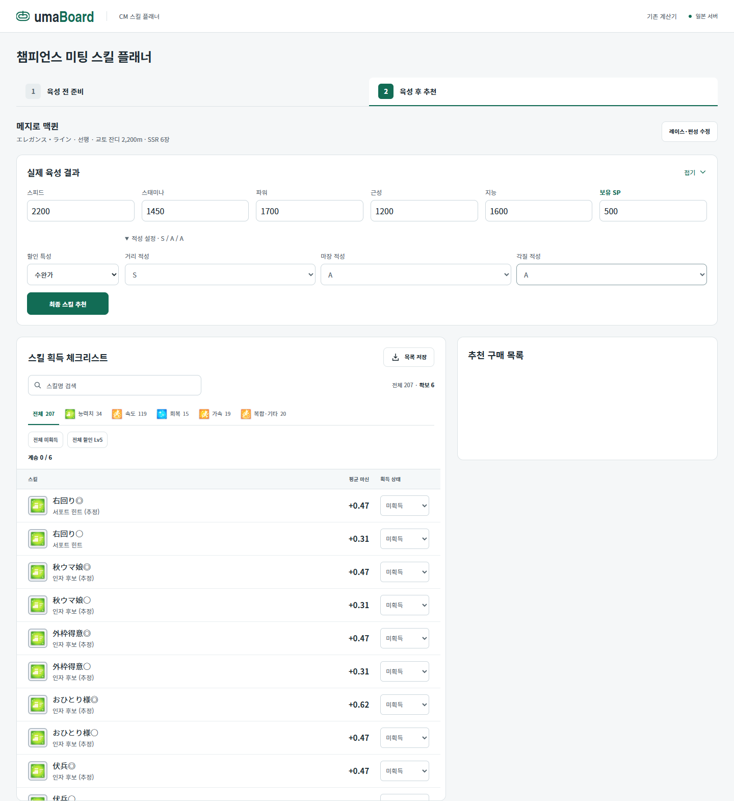
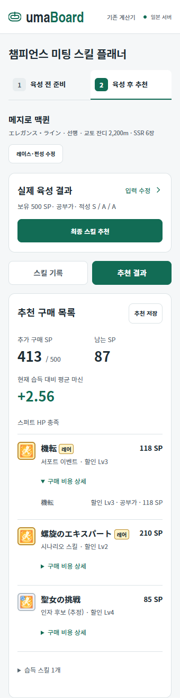

# 할인 특성·전체 화면 확인 — 2026-11-17

수완가 체크박스를 **없음 / 공부가 / 수완가** 네이티브 드롭다운으로 바꿨다.
할인율은0/4/10%다. 공부가와 수완가는 중복하지 않고 각 미지불 단계의 힌트
할인율에 합산한 뒤 정수 내림한다. 기습득 단계·진화 자체에 비용을 추가하지 않는다.

공부가4%, 힌트Lv5와 합계44%, 기본200→112 SP는 [공개 계산 예시](https://note.com/neko_chomei/n/ne24b7a222685),
수완가 획득 시 공부가 대체는 [조건 정리](https://note.com/herohero_3/n/nbdb862bdc513)로 확인했다.
이는 공식 검증 인증을 뜻하지 않는다. 기존 수완가·단계별 가격 정책은
[추천 계약](CM_POST_TRAINING.md)을 유지한다.

## 저장과 계산

`cm-discounts.mjs`가 선택·표시 이름·할인율을 공유한다. 새 명시 선택이 우선하며,
기존 `fastLearner:true`는 수완가, false/누락은 없음으로 복원한다. 계획 키와 스탯·
습득 기록은 바꾸지 않는다. 새 저장·결과에는 `discountTrait`를 기록하고 기존
boolean도 선택에 맞춰 제공한다. 공부가에서는false이므로14%로 중첩될 수 없다.

새 테스트3개는 이전 boolean 복원·명시 선택 우선·잘못된 값 거부, 힌트0~5의4%
할인·단계별 내림·공유 단계 중복 제외·기습득/진화/계승 비용, 예산56 SP의
추천 가능 여부(없음60/공부가56/수완가50)를 확인한다.

## 실제 화면 확인

이전 바탕화면 실행본에서 수완가와 실제 입력·획득 기록을 저장한 뒤 같은 주소에
새 빌드를 제공했다. Edge에서207행의 순서·마신값·기록과 수완가가 복원됐다.
기본 맥퀸/교토2200m/선행/시나리오15/SSR6장, 실제 SP500의 비교는 다음과 같다.

| 선택 | 사용 SP | 잔여 SP |
| --- | ---: | ---: |
| 없음 | 441 | 59 |
| 공부가 | 413 | 87 |
| 수완가 | 377 | 123 |

공부가의 각 구매 단계에4%가 기록됐고 단계별 합계가 총액과 일치했다. 비용 상세와
접힌 입력 요약의 이름도 공부가로 표시됐다. 새로고침 후 공부가·실제 입력·
획득 기록이 유지됐다. 변경 시 이전 추천/저장이 무효화되고 새 추천을 요구한다.

PC 준비·기록·추천·실제 입력·적성 개방, 모바일 기록/결과 전환과320/340/390/
720/860/861/1024/1440px,340×520 선택창을 확인했다. 네이티브 특성 팝업의
키보드 선택과 Escape 복귀도 확인했다. 가로 넘침·페이지 오류·실패 응답·외부
요청0건, 코스·서포트·목록·추천 가격의 기존 정렬이 유지됐다.

확인 중 펼친 입력의 중복 요약을 숨기고 제목과 입력 사이16px을 확보했다.
PC에서 적성 세 칸을 할인 선택과 같은 줄에 정렬해 넓은 빈 공간을 줄였다.
모바일에서는 적성을 다음 줄로 펼쳐 각 조작 영역을 유지한다. 일반 설명문은 추가하지 않았다.

Node178개·Python42개, 빌드·구문·공백·엄격 정적 UI 점검 통과. 디자인 문서
오류0건(기존 미사용 참조 경고6건). 실제 휴대폰 하드웨어·가상 키보드와 다른
브라우저 엔진은 미검증이며 기존 조합 탐색·물리 계산 한계를 유지한다.
