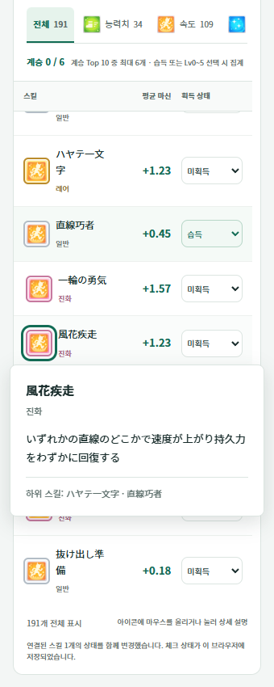

# CM first-chart verification — 2026-11-16

Branch: `feat/cm-first-chart`, based on main `e96b037`.
Active JP dataset: `d7de1b78dac16a10ac579793134f708928332a4ed30546dba66a91daf73e9a0a`.

## Automated checks

| Check | Result |
| --- | --- |
| `node --test tests/*.test.mjs` | 142 passed, including 33 first-chart/UI/state checks |
| `python -X utf8 -m unittest discover -s tests -v` | 39 passed on native Windows, including two CP949-default UTF-8 regressions; canonical fixtures explicitly retain LF bytes |
| `python scripts/validate_data.py` | Passed |
| `python scripts/build_pages.py --output dist --fetch-portraits` | Passed; all 273 outfit and 319 SSR portraits available |
| Strict static UI audit | Zero findings in the configured `assets/` source directory |
| `npx --yes -p @google/design.md designmd lint DESIGN.md` | Zero errors; six unused-token reference warnings |
| `git diff --check` | Passed |

The static audit accepts directory roots and recognizes inline/framework click
handlers only. Root HTML uses external module event listeners. Its entry markup
is covered by the UI contract tests and the interaction checks below; the asset
audit alone is not claimed as a full accessibility audit.

## Browser checks

The staged site was exercised in headless Microsoft Edge on Windows through a
temporary loopback-only server, with production 24-sample/0.01s generation.

| Flow | Observed result |
| --- | --- |
| Default MacQueen, Kyoto turf 2200m, six SSRs, scenario 15 | All 207 admitted candidates rendered, including the locked inherited Top10 |
| Full list | DOM row count equals the exported full pool; no load-more control; bounded table scrolling |
| Acquisition select | Eight choices; Lv3 persisted without recalculating/reordering |
| Reload and regenerate same setup | Recorded Lv3 restored |
| Recovery search | `コーナー回復○` retained with `0.00` lengths |
| Korean support search | MacQueen cards found and disabled for the same training character |
| Picker close | Explicit close and Escape restore the invoking support button; IME composition is preserved |
| Owned profile | Unique level 5 saved and reflected, then restored to 6 |
| Cancel and rerun | Cancel returns control immediately; stale worker messages ignored; rerun completes |
| Export | JSON contains 207 rows and ten inherited IDs, fixed five-stat profile, model version, 24-sample/0.01s settings and the saved acquisition state |
| Narrow layout | 340px browser viewport; document width and scroll width both 340px; no horizontal overflow |
| Icon category tabs | Six category tabs, counts 207 / 34 / 123 / 15 / 19 / 16; icon-based classification; arrow/Home navigation; checks retained across tabs |
| Search with tabs | Dedicated no-results state; clearing restores every matching row in the current category |
| Inheritance limit | Ten inherited rows total, six recorded allowed, seventh restored to unavailable with explanation; releasing a slot allows a different skill |
| Strengthened inherits | Export contains 91101411 and no weaker 901411; no pure healing inherit in shortlist |
| Portraits | All six selected support frames loaded at 48×48 with contain; type icons beside names |
| Narrow diagram/tabs | At 340px, the document has no horizontal overflow; component scroll areas remain operable |
| Skill details | Hover, moving into the tooltip, keyboard focus, click/tap-style activation, Escape and close-on-second-click exercised; source description and lower-skill names shown |
| Rarity | 일반/레어/진화 labels and three distinct frame colors verified; no 금딱 label in rows |
| Acquisition chain | Acquiring an evolution acquires each admitted lower stage; marking the lowest unavailable clears the upper; persisted chain restores after reload |
| Alternative evolution | Nishino Flower outfit 105101: acquiring 105101111 then 105101121 clears the former and keeps the common base acquired; clearing the base clears both evolutions |
| Narrow tooltip | At 340×850, left12/right328 and top451.30/bottom638.67; popup fully inside viewport; no page errors |

Narrow layout testing used a 340×850 browser viewport. Physical touch hardware
and other browser engines have not been tested.

The Windows local-build failure was reproduced by modeling CP949 as the default
for text file reads/writes. The full staging path and validation CLI are now
tested with Korean, Japanese and emoji content in UTF-8 manifests, reports,
modules, HTML and portrait metadata. This is a locale simulation on the test
host and has now also passed on native Windows. Text encodings are explicit
in the build/data utilities, and README includes the UTF-8-mode command that
also works with an older downloaded ZIP.

## Model limits retained deliberately

- Independent skill contribution after trigger conditions succeed; no opponent
  simulation, win probability, or final SP optimization claim.
- Scenario MAX uses verified base caps, excluding inheritance-dependent raises.
- Above speed 2000, full-spurt uses the documented public approximation whose
  ceiling remains unknown.
- Missing display metadata has a stable fallback; exact game ordering for every
  new skill is not verified.
- Unknown skill calculations are excluded; an unsupported native unique stops
  generation with a recoverable error.

See [calculation contract](CM_FIRST_CHART.md) for source pins and policies.

## Pool regression audit

Ten representative turf/dirt courses (including straight1000, Kyoto2200 and
long3200), each with four running styles: 40 setups. Fixed-gate violations: zero.
The separate awakening/evolution scan now finds zero missing obtainable original
gold rows (previous audit found 773 cases across 70 outfit/base families).
60 distinct skills remain unsupported across this matrix because their effect,
duration, target, repeat or other math is still outside the model; they remain
excluded. This is not a complete game-engine validation or a proc-rate study.

Numerical and policy regressions cover CM9 rounded rank thresholds, exact-sixth
Anabolic suitability, broad-middle overlap, restored trigger-only skills,
tight-track flags, final-straight latter-half semantics, 200m furlong windows,
orphan link exclusion, strengthened inherit replacement/style gates, ordinary
zero-gain healing, locked positive Top10, shared six-slot state and course geometry.
The legacy test that expected a wrong-style orphan acceleration was corrected to
expect inactivity; the full suite passes with the physical-link correction.

Browser generation/JSON used the production 24 samples and dt0.01. Narrow testing
used a 340px Edge viewport; touch hardware and other browser engines remain untested.

