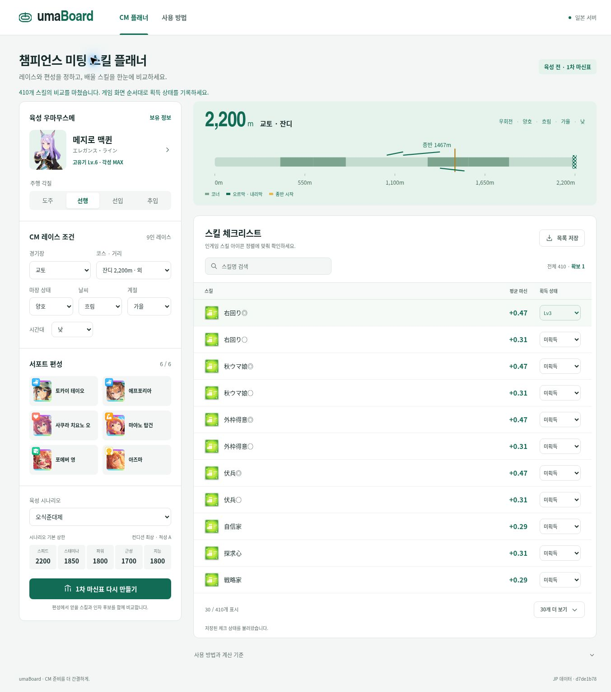

# CM first-chart verification — 2026-11-16

Branch: `feat/cm-first-chart`, based on main `e96b037`.
Active JP dataset: `d7de1b78dac16a10ac579793134f708928332a4ed30546dba66a91daf73e9a0a`.

## Automated checks

| Check | Result |
| --- | --- |
| `node --test tests/*.test.mjs` | 124 passed, including 15 first-chart/UI checks |
| `python -m unittest discover -s tests -v` | 37 passed |
| `python scripts/validate_data.py` | Passed |
| `python scripts/build_pages.py --output dist --fetch-portraits` | Passed; all 273 outfit and 319 SSR portraits available |
| Strict static UI audit | Zero findings in the configured `assets/` source directory |
| `npx --yes -p @google/design.md designmd lint DESIGN.md` | Zero errors; six unused-token reference warnings |
| `git diff --check` | Passed |

The static audit accepts directory roots and recognizes inline/framework click
handlers only. Root HTML uses external module event listeners. Its entry markup
is covered by the UI contract tests and the interaction checks below; the asset
audit alone is not claimed as a full accessibility audit.

## Browser checks

The staged site was exercised through the managed preview in Chromium.

| Flow | Observed result |
| --- | --- |
| Default MacQueen, Kyoto turf 2200m, six SSRs, scenario 15 | 410 supported candidates, first 30 shown |
| Load more | 60 rows, original order and recorded hint preserved |
| Acquisition select | Eight choices; Lv3 persisted without recalculating/reordering |
| Reload and regenerate same setup | Recorded Lv3 restored |
| Recovery search | `コーナー回復○` retained with `0.00` lengths |
| Korean support search | MacQueen cards found and disabled for the same training character |
| Picker close | Explicit close and Escape restore the invoking support button; IME composition is preserved |
| Owned profile | Unique level 5 saved and reflected, then restored to 6 |
| Cancel and rerun | Cancel returns control immediately; stale worker messages ignored; rerun completes |
| Export | JSON contains 410 rows, fixed five-stat profile, model version, 24-sample/0.01s settings and the saved acquisition state |
| Narrow layout | At 340 CSS px via browser zoom, document width 338px and table width about 302px; no horizontal overflow |
| Portraits | All six selected support portraits loaded successfully |

Narrow layout testing used browser zoom, not a mobile-device emulator. Touch
hardware and other browser engines have not been tested.

## Model limits retained deliberately

- Independent skill contribution after trigger conditions succeed; no opponent
  simulation, win probability, or final SP optimization claim.
- Scenario MAX uses verified base caps, excluding inheritance-dependent raises.
- Above speed 2000, full-spurt uses the documented public approximation whose
  ceiling remains unknown.
- Missing display metadata has a stable fallback; exact game ordering for every
  new skill is not verified.
- Unknown skill calculations are excluded; an unsupported native unique stops
  generation with a recoverable error.

See [calculation contract](CM_FIRST_CHART.md) for source pins and policies.
