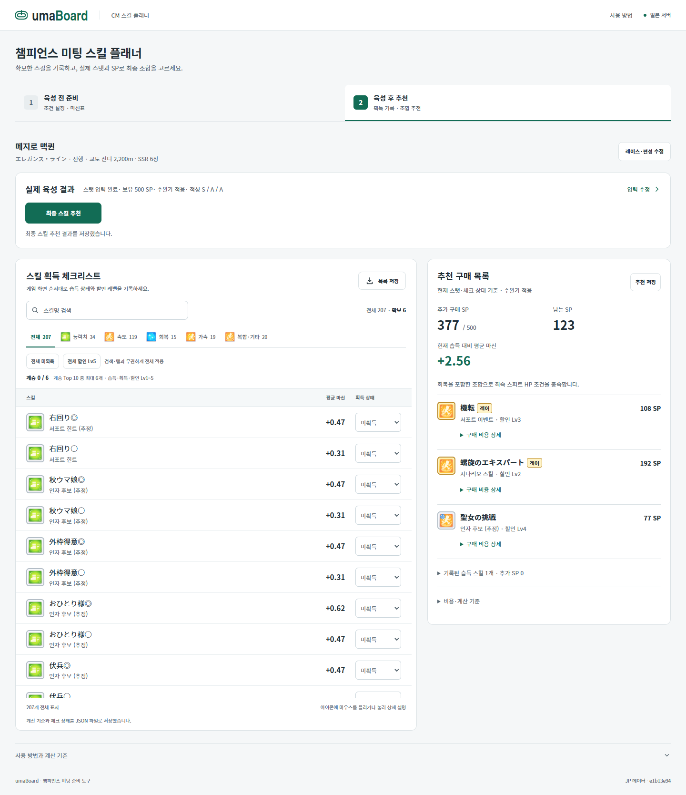
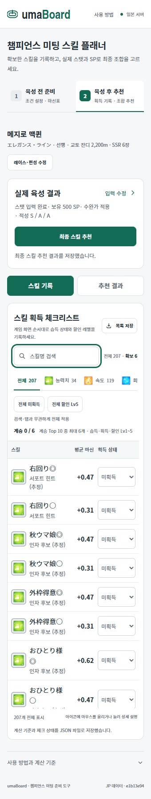
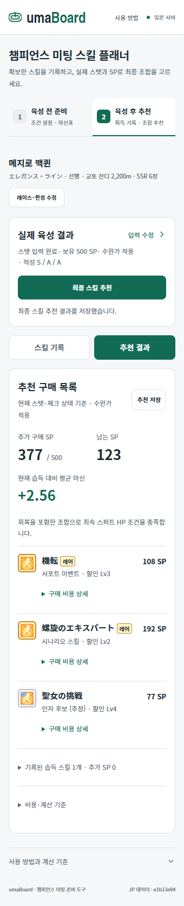

# 모바일 기록·추천 전환 검증 — 2026-11-16

후속 문구 제거·수직 정렬은 [화면 정리 기록](CM_UI_CLEANUP_QA.md)을 따른다.

승인한 디자인 추천을 실제 화면에 적용했다. 모바일 기록/결과 전환, 추천 성공
후 입력 접기, 스킬명·획득 경로의 가독성과 목록 밀도가 범위다. 기존 두 육성
단계, 후보·가격·물리 계산, 저장 키와 저장 형식은 유지했다.

## 화면과 상태

- 실제 입력은 기록·추천의 공통 영역이다. 새 마신표나 저장된 입력을 불러오면
  펼쳐지고, 성공한 추천은 입력칸을 요약으로 접는다. 언제든 다시 펼칠 수 있고
  접기 자체는 추천을 무효화하지 않는다.
- 추천·중지·진행·상태 안내는 접힌 영역 밖에 남는다. 잘못된 입력은 자동으로
  펼쳐 첫 오류로 이동한다. 기존 검증과 실제 보유 SP 기준을 유지한다.
- 860px 이하의 **스킬 기록 / 추천 결과** 탭은 같은 기존 패널을 전환한다.
  성공하면 결과 표시 후 제목으로 이동한다. 데스크톱은 두 패널을 함께 표시한다.
  화면 크기 변경 시 숨겨지는 입력·탭에 포커스를 남기지 않는다.
- 스킬명15px·획득 경로12px·행 위아래 여백10px을 공통 변수로 관리한다.
  모바일 획득 선택은12px/높이44px이며 기존 들여쓰기와 정렬을 유지한다.

## 이전 기록과 실제 빌드

Windows Edge의 별도 환경에서 이전 바탕화면 빌드로 기록을 만든 뒤 같은 주소와
저장 공간에 새 빌드를 제공했다. 기본 맥퀸, 교토 잔디2200m, 선행, SSR6장,
시나리오15의207개 후보를 기본24표본/0.01초로 생성했다.

| 확인 | 결과 |
| --- | --- |
| 이전 저장 복원 | 습득/할인·5스탯·SP500·수완가·거리S 유지; 내보낸 상태 일치 |
| 목록과 계산 | 207행ID·순서·마신값 동일, 체크리스트 DOM 하나 |
| 추천 비용 | 수완가377/잔여123, 해제441/잔여59로 기존과 동일 |
| 접기와 오류 | 성공 후 자동 접기·요약 갱신·수동 개방·접힌 상태 재추천 정상; 빈 스피드는 자동 펼침·aria-invalid·첫 오류 포커스 |
| 모바일 작업 | 클릭·Arrow/Home/End 전환, 검색어·기록·목록 스크롤230px 유지 |
| 반응형 경계 | 1440/1024/861px 병렬,860/720/340px 한 패널; 가로 넘침0 |
| 수정·취소 | 이전 결과·저장 무효화, 중지 후 입력과 기록 유지 |
| 저장 범위 | 재접속 후 입력 개방·복원; 다른 레이스 입력은 분리하고 원래 조건에서 복원 |
| 기존 습득 기능 | 상하위 연동, 전체Lv5의 계승6개 한도, 전체 미획득 정상 |
| 진화 | 니시노 플라워105101의 양방향 분기 전환 시 반대 진화 해제 |
| 글자 크기 | 실제 이름15px·경로12px·선택12px; 모바일 첫 예시 행83.58px |
| 오류·자산 | 페이지 오류0, 실패 응답0, 외부 요청0 |

Node175개·Python42개 통과. 새 워크플로우 테스트2개는 단계 잠금·단일 목록,
키보드·화면 크기 변경 시 포커스 복구를 확인한다. 엄격 정적 UI 점검0건,
디자인 문서 오류0건(기존 미사용 참조 경고6건), 빌드·구문·공백 검사 통과.

첫 화면 확인 후 요약의 적성 묶음과 추천 상태 문구 줄바꿈을 보완해 최종 확인했다.
실제 휴대폰·가상 키보드와 다른 브라우저 엔진은 미검증이다. 기존 모델의 계산
한계를 유지한다. [추천 계약](CM_POST_TRAINING.md)과 [행동 계약](../UX-CONTRACT.md)을 따른다.
