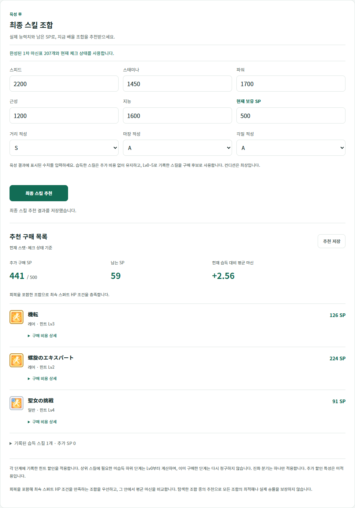
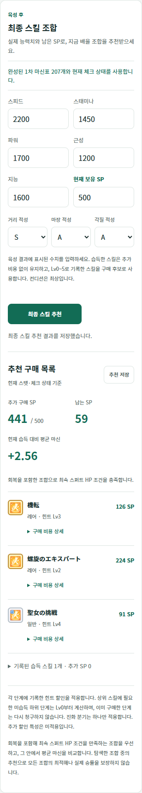

# Post-training recommendation verification — 2026-11-16

Branch: `feat/cm-first-chart`. Dataset remains
`e1b13e942888b9c45d42aebb2566d275b31ea2a11596f1880ee89ec5ba0f1775`.
The first-chart model remains `cm-first-chart-v2`; final recommendation uses
`cm-post-training-v2`. The no-trait example below retains its original prices;
Fast Learner, bulk settings and badge/source verification are recorded in
[the follow-up QA](CM_CHECKLIST_POLISH_QA.md).

## Automated checks

- All172 Node tests and42 Python tests passed.
- Fourteen final-plan regressions cover stage-specific hints, shared and paid
  prerequisites, actual stats/aptitudes, upgrades, free evolution, alternative
  locks, unavailable/unknown-price exclusions, combination search, zero SP,
  cancellation, hint-dependent affordability, recovery, scenario/inherited limits,
  real JP costs, complete affordable packs under bounded search, additive
  Fast Learner discounts and the resulting affordability change.
- UI contracts cover separate pre/post forms, labels and explicit invalid state,
  cancellation/stale replies, scoped drafts and no native alert/validation bubbles.
- Active-data validation, production build, script syntax and strict static UI
  audit passed. No dataset content or portrait/icon source changed.
- The existing full-catalog sorting,1,085 purchase chains and2,340 ordered
  evolution transitions remain covered by the passing suite.

## Windows Edge workflow

A fresh headless Edge context served the production build over a temporary
loopback-only server. The default MacQueen/Kyoto2200/six-SSR/scenario15 setup
generated207 first-chart rows. The final inputs were speed2200/stamina1450/
power1700/guts1200/wisdom1600, distanceS/surfaceA/styleA, remaining SP500.

Recorded states were: 如才なし204732 owned; 機転204731 Lv3;
螺旋のエキスパート204811 Lv2; 弧を描いて204812 Lv5;
恩返し、召し上がれ210392 Lv2; 聖女の挑戦204453 Lv4.

| Observed result | Value |
| --- | --- |
| Recommended targets | 機転204731 / 螺旋のエキスパート204811 / 聖女の挑戦204453 |
| Additional prices |126 /224 /91 SP; paid204732 is not charged |
| Used/remaining |441 /59 SP |
| Mean lengths over acquired baseline |+2.55565, displayed+2.56 |
| Final evaluation |24 samples /0.01s, actual joint combinations |
| HP feasibility |Satisfied in the tested samples |
| First result |About0.66s on this test host, excluding first-chart generation |

The browser exercised the following transitions:

1. Disabled post form before a complete chart; blank input validation, text,
   aria-invalid and focus on the first invalid stat.
2. Actual stats/SP/aptitude applied in exported result; purchase/stage totals
   equal the reported budget and stay within it.
3. First-chart numerical rows and every acquisition value identical before and
   after recommendation. New results never mark skills purchased automatically.
4. Editing SP invalidates export and marks the old result; zero-SP rerun retains
   the acquired baseline with no new purchases.
5. Cancel restores control; editing an input during computation stops the job;
   delayed replies never re-enable export or publish stale results.
6. Reload and first-chart regeneration restore actual inputs and hints/owned
   states for that plan. Editing checklist state invalidates the final result.
7. Changing race conditions disables the post form until a fresh first chart.
8. At340×850, document/client scroll widths are both340px. All fields, native
   selects, purchase rows and controls remain within the document flow.

Page errors, failed application-asset responses and external requests: zero.
The test server responds204 to the browser's optional favicon probe.

## Larger candidate set

With203 recorded available candidates,3000 SP and the same actual stats, the
bounded search recommended15 targets costing2996 SP with4 SP remaining. The
actual combination gained+19.06820 lengths over the native-only baseline and
passed the HP check. It completed254 combination evaluations, shortlisted38
targets and took about1.02s on this host. This is a smoke/performance observation,
not proof of the global optimum or a performance guarantee on other devices.

Touch hardware and other browser engines were not tested. Fast Learner is now
supported with a persistent native checkbox. Other numerical assumptions and
the bounded-search limit are retained in [the contract](CM_POST_TRAINING.md).

