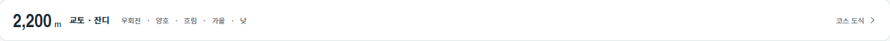
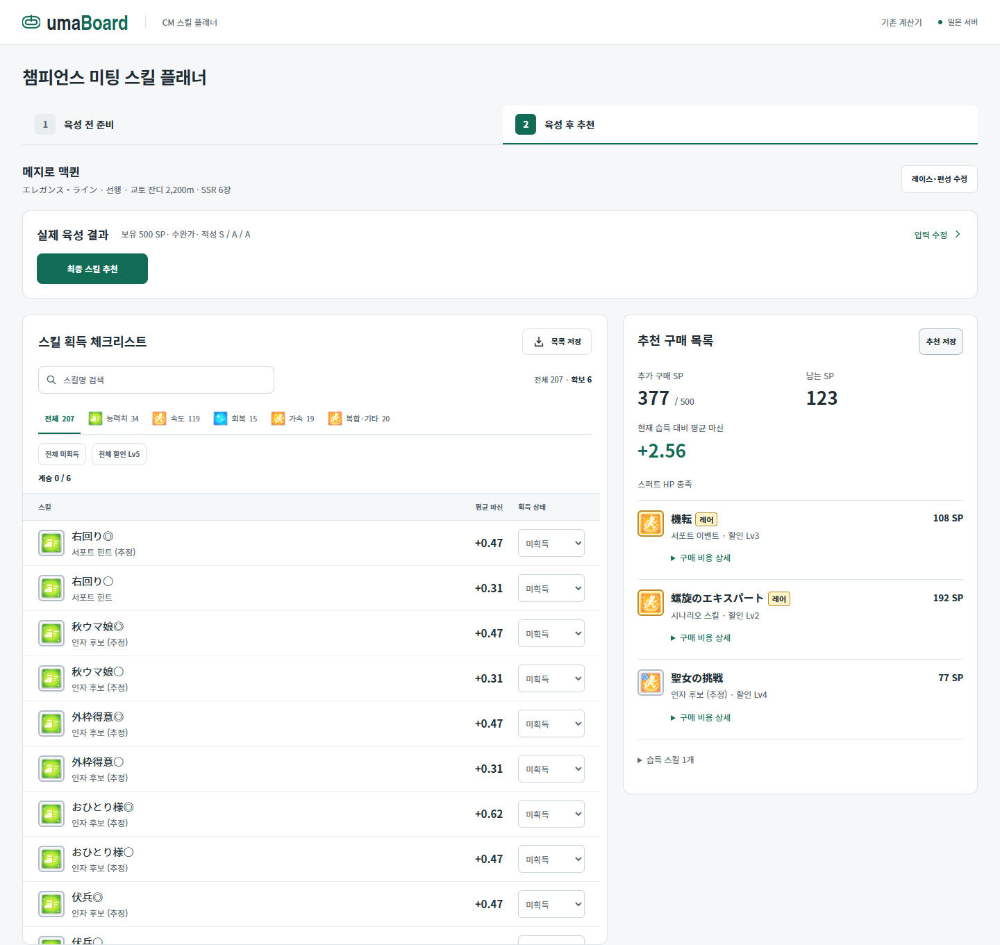

# 화면 문구·정렬 정리 — 2026-11-16

사용자가 지적한 계산 기준 설명과 목록 아래 안내를 제거하고, 수직 정렬과
정보 계층을 점검했다. 화면에는 작업명·입력·스킬 정보·결과·필요한 상태를 남겼다.

- 비용·계산 기준 정책 설명, 목록 하단 전체 표시/아이콘 사용법, 저장·복원·
  내보내기 완료 문구, 반복 부제·일괄 처리 설명·도움말·버전 푸터를 제거했다.
- 오류·진행·중지·저장 실패·계승 한도와 HP 충족 여부는 짧게 남겼다. 재추천이
  필요하면 결과를 구분하고 내보내기를 비활성화한다. 빈 상태 영역은 공간을 차지하지 않는다.
- 코스 거리·경기장·조건을 수직 중앙 정렬했다. 거리 단위는 숫자와 기준선을
  공유한다. 서포트 타입 아이콘·이름, 각질 버튼과 목록 행을 중앙 정렬했다.
  추천 가격은 스킬명과 같은 행 안에서 정렬하고 부가 정보·비용 상세는 아래에 둔다.

Edge의 실제 빌드에서1440/1024/861/860/720/340px를 확인했다. 데스크톱에서
코스 요소의 중심선 차이0.008px 미만, 서포트 아이콘/이름0px, 추천 이름/가격 및
목록 정보/아이콘/선택칸0.008px 미만이었다. 좁은 폭의 거리/경기장도1px 미만이다.
이는 요소 상자의 기하학적 중심 비교이며 모든 글꼴의 잉크 모양이 같다는 뜻은 아니다.

이전 실행본으로 만든 기록을 새 빌드에 복원했다.207행ID·순서·마신값과 실제
입력·힌트·습득 기록이 일치했다. 추천은 수완가 적용377 SP/잔여123, 미적용441 SP로
기존과 같았다. 모바일 전환·접기·오류 포커스·취소·재접속·계획 분리·상하위 습득·
진화 분기·계승6개 한도와 JSON 저장을 확인했다.340×520 선택창과 Escape 복귀도
확인했다. 가로 넘침·페이지 오류·실패 응답·외부 요청은0건이다.

Node175개·Python42개, 빌드·모듈 구문·공백 검사와 엄격 정적 UI 점검이 통과했다.
디자인 문서 검사 오류0건이며 기존 미사용 참조 경고6건은 동일하다. 계산·가격·
저장 형식은 변경하지 않았다. 실제 터치 기기와 다른 브라우저 엔진은 미검증이다.

[추천 계약](CM_POST_TRAINING.md) · [이전 모바일 검증](CM_MOBILE_WORKFLOW_QA.md)
