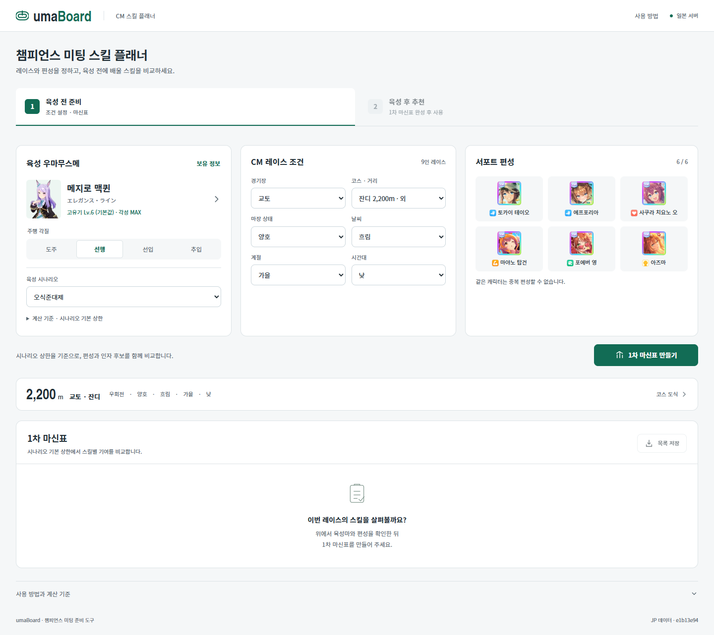
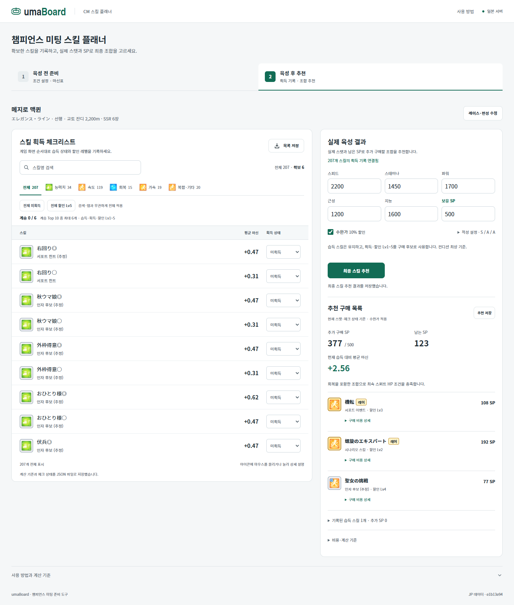
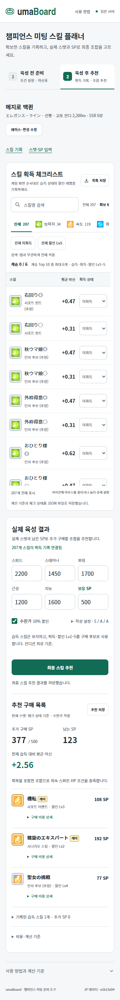

# CM 단계형 UI 개편 검증 — 2026-11-16

이후 모바일 기록/추천 전환과 입력 자동 접기는 [추가 검증](CM_MOBILE_WORKFLOW_QA.md)을 따른다.

사용자가 선택한 흐름은 **육성 전 준비 → 육성 후 추천**이다. 기존의 긴 설정
열과 완료 전에도 노출되던 실제 결과 입력을 두 단계로 재구성했다. 계산 데이터,
가격, 물리 모델, 저장 키는 변경하지 않았다.

| 검토한 문제 | 반영한 구성 |
| --- | --- |
| 설정·결과·실제 입력의 시작점이 불분명 | 번호가 있는 두 단계 탭, 마신표 완료 후에만 추천 단계 활성화 |
| 왼쪽 설정 열이 길고 오른쪽과 높이가 크게 다름 | 육성마·레이스·서포트 세 그룹, 아래 전체 폭 마신표 |
| 초기 화면의 부가 정보가 많음 | 계산 기준·코스 도식은 펼쳐 보기 |
| 구매 기록과 실제 입력을 번갈아 보기 어려움 | 데스크톱에서 목록과 입력·추천 병렬 배치, 휴대폰에 바로가기 |
| 버튼·입력칸·텍스트 강조가 비슷함 | 초록은 주요 행동·현재 단계·습득 강조, 나머지는 중립색; 공통 간격·높이·아이콘 정리 |
| 힌트 후보가 많으면 목록 전체가 강조됨 | 습득한 행만 바탕 강조, 할인 상태는 선택칸으로 구분 |
| 짧은 선택창에서 하단 작업에 접근하기 어려움 | 옵션 영역만 스크롤, 헤더·검색·하단 작업 유지; 보유 정보 내부 스크롤 |

## 동작 확인

실제 배포 빌드를 임시 로컬 서버에서 Microsoft Edge로 실행했다. 기본 맥퀸,
교토 잔디2200m, 선행, SSR6장, 시나리오15를 사용했다. 마신표와 최종 비교는
실서비스 기본값인24표본/0.01초를 사용했다.

| 항목 | 결과 |
| --- | --- |
| 시작·진행 | 첫 단계 표시, 추천 잠금, 완료 후207행과 다음 단계 버튼 표시 |
| 단계 전환 | 체크리스트 DOM은 하나; 행ID·순서·마신값·검색·기록·실제 입력·유효한 추천 유지 |
| 키보드 | 방향키로 단계 전환, 선택창 Escape 후 호출 버튼 복귀 |
| 실제 입력 검증 | 빈 값에 설명·aria-invalid·첫 오류 입력 포커스 적용 |
| 추천 비용 | SP500, 수완가 및 기록한 할인 적용: 구매377/잔여123, 평균+2.56마신; 수완가 해제441, 재선택377 |
| 기존 기록 기능 | 상하위 자동 습득, 전체Lv5의 계승6개 제한, 전체 미획득, 검색 복귀 시 순서 유지 |
| 변경·중지 | 입력 변경 시 이전 추천/저장 비활성화; 추천 중지 정상; 레이스 변경 시 추천 단계 잠금 |
| 재접속 | 준비부터 재시작; 같은 설정으로 생성하면 해당 계획의 SP500·수완가 복원, 다른 설정의 입력은 분리 |
| 화면 폭 | 1440/1024/720/340px 확인; 1024/720/340px에서 문서 가로 넘침0 |
| 짧은 선택창 | 340×520px에서 하단 작업 bottom508px; 보유 정보 저장 버튼까지 스크롤 가능; SSR 원본 프레임 contain |
| 자산·오류 | 페이지 오류0, 실패 응답0, 외부 요청0 |

대표 작은 글씨의 실제 계산 대비는 페이지 설명5.44:1, 서버·경로·입력 라벨·
활성 단계 부제5.84:1, 추천 버튼6.36:1, 레어 배지12.70:1이었다. 모든 상태의
접근성 인증을 뜻하지 않는다. 실제 터치 기기와 다른 브라우저 엔진은 미검증이다.

## 자동 검증과 범위

- Node173개, Python42개 통과.
- 배포 빌드 성공: 의상273종·SSR319장·스킬 아이콘128개 로컬 제공.
- 엄격 정적 UI 점검0건, 디자인 문서 검사 오류0건(기존 미사용 참조 경고6건).
- 변경 파일 구문 검사와 공백 검사 통과.

초기 화면 검토 후 한 번의 수정 묶음으로 좁은 단계 문구, 경로 줄바꿈, 짧은
선택창과 SSR 프레임을 보완하고 최종 확인을 마쳤다. Impeccable 문맥 실행기는
설치된 엔진을 찾지 못해 실행되지 않았으므로, 해당 자동 검사 실행을 주장하지
않는다. 기존 제품·디자인 문서, 정적 점검과 실제 브라우저 검증을 사용했다.

숫자·정렬·저장 기준은 [1차 계약](CM_FIRST_CHART.md),
[최종 추천 계약](CM_POST_TRAINING.md)을 유지한다.
