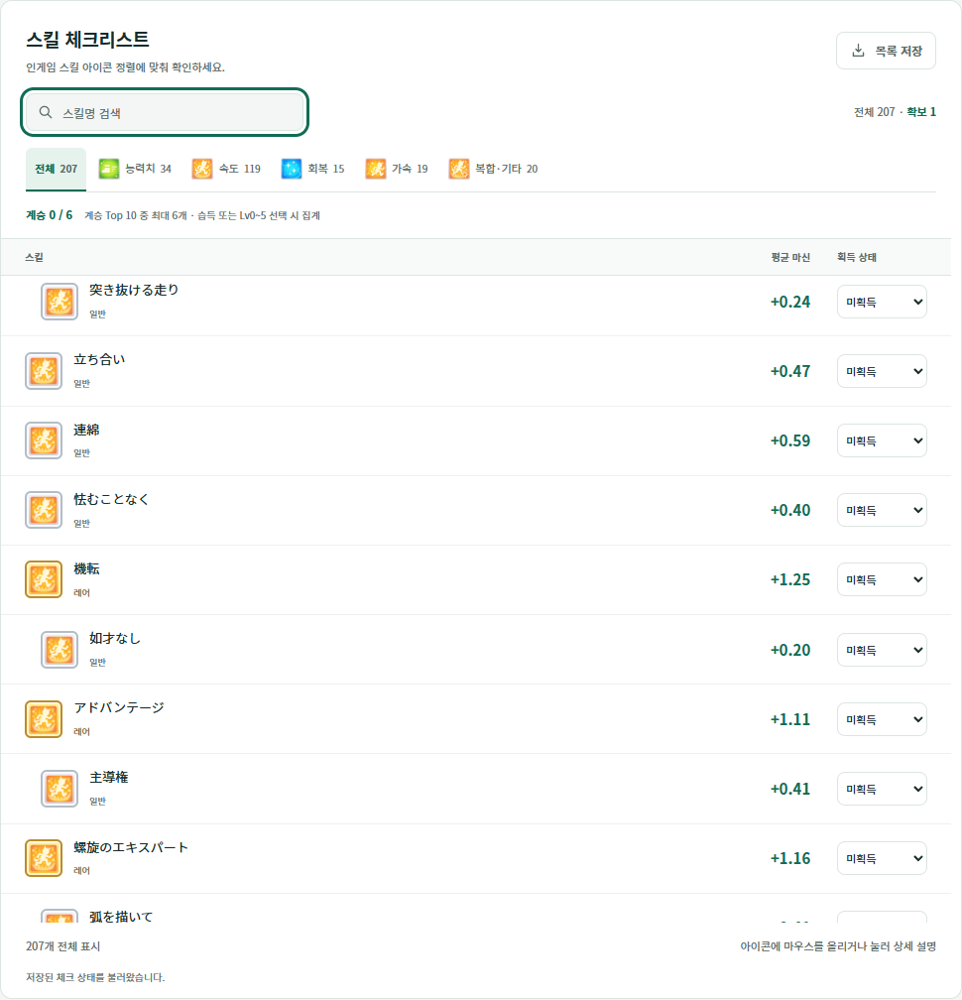

# Skill icon verification — 2026-11-16

Branch: `feat/cm-first-chart`.
Active dataset: `e1b13e942888b9c45d42aebb2566d275b31ea2a11596f1880ee89ec5ba0f1775`.

## Full inventory

The audit exercises production `sortChartRows` and image resolution for all
2,229 normalized JP records. This includes native uniques and special/event
records; a particular race/deck checklist admits only a subset.

| Check | Before | After |
| --- | ---: | ---: |
| Missing displayed icons | 77 | 0 |
| Displayed icon differs from its primary source ID | 20, all evolutions | 0 |
| Registered local PNGs | 113 | 128 |
| Registered files missing or failing SHA-256 | 0 | 0 |

Of the 77 missing records, 48 already had a bundled image but lacked a working
connection. Another 16 needed seven PNGs from the existing pinned alpha source;
the remaining 13 needed seven PNGs from GameTora. Of the 20 incorrectly displayed
evolutions, 14 could use existing images and six needed GameTora icon20386.
Thus 15 additional image files resolve all 97 affected records.

## Identity and sources

The pinned UmaTools skill blob
`2e24fab8f7da62fdb869cae125d42f88f4bb050b` supplies each record's own `iconid`.
Normalization now preserves it as `icon_id` for 2,226 records. The three
secondary-only inherited records (901351, 901411, 911091) use their independently
recorded same-ID alpha display metadata. Grouping may follow a lower stage;
image selection does not borrow that stage's image.

Seven added PNGs come from `alpha123/uma-tools` commit
`dfbeafb23253b238a0417ddd4dde70a36fd11d4f`: 1010011, 1010021, 1010031,
1010041, 1010051, 20015 and 20045. Their Git blob hashes were verified.

Eight additional originals come from [GameTora](https://gametora.com/umamusume/skills):
2010011, 20361, 20362, 20366, 20376, 20381, 20382 and 20386. All are 64×64 PNGs.
Exact media URLs, source evidence, SHA-256, dimensions and byte counts are
retained in `curated/cm-skill-display.json`. All 128 images are bundled locally.

## Browser and regression checks

Headless Microsoft Edge exercised the production 24-sample/0.01s default setup:

- All 207 admitted images decoded successfully and matched their own source ID.
- Twelve affected examples included 怯むことなく, 機転, 如才なし,
  アドバンテージ, 恩返し、召し上がれ, 聖女の挑戦, 彼方の呼び声 and
  evolution 捧ぐる願い. Search and details worked for the external-source images.
- A saved hint4 from the pre-icon bundle restored correctly. A new hint2
  survived reload and regeneration; export recorded the actual new version.
- At 340×850, document width and scroll width both remained 340px.
- No page errors, external network requests or failed PNG responses occurred.

The new dataset, after removing only `skills.*.icon_id`, is byte-canonically
identical to the previous dataset. `checklist_data_sha256` therefore equals the
previous dataset version and retains saved plans. A unit regression also proves
that a mechanics change still creates a different plan scope.

All 147 Node tests and 42 Python tests passed; active data validation, production
build, script syntax and strict static frontend audit passed. PNG identity and
integrity now run as catalog-wide regressions.

